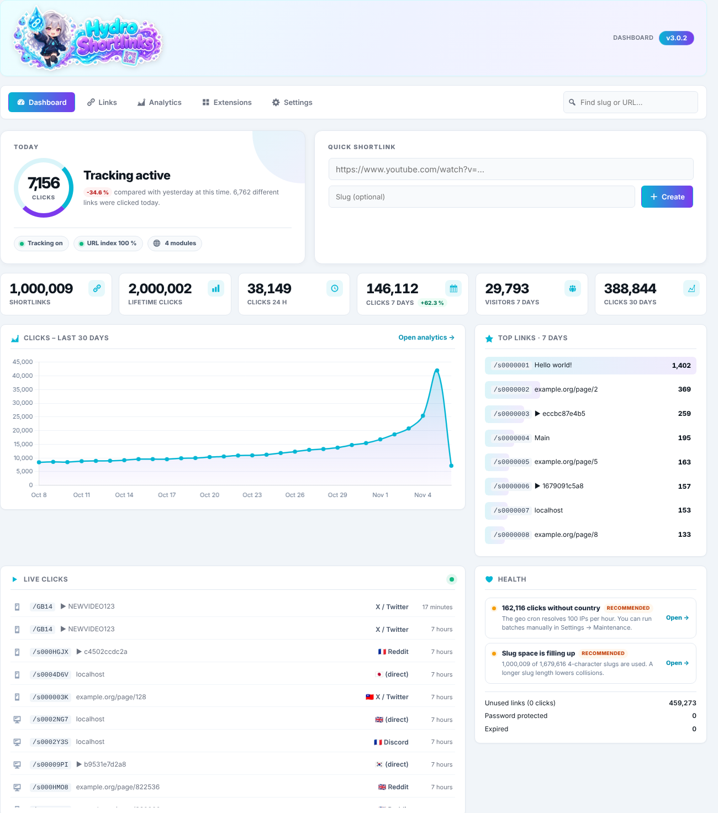
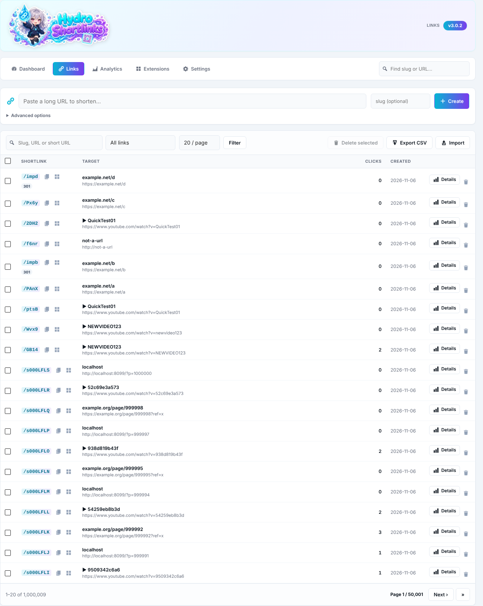
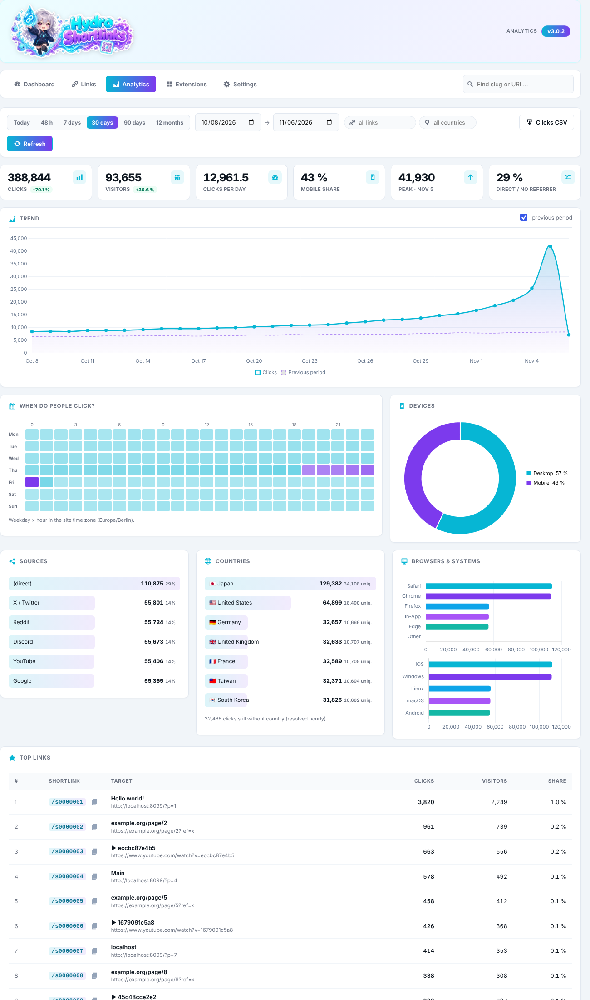
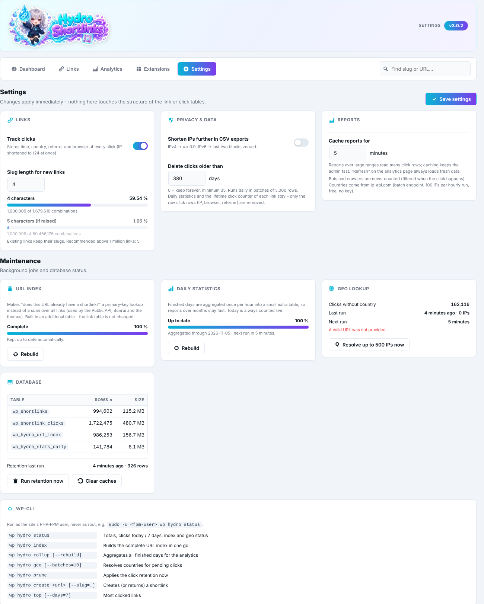

<p align="center"></p>


# 💧 Hydro Shortlinks (WordPress URL Shortener)

**Hydro Shortlinks** turns your WordPress domain into a fast, self-hosted URL shortener: `https://example.com/abcd` → anywhere.
It tracks every click, shows where visitors come from and keeps working at scale – Hydro is built for installations with **millions of links and clicks**.

No external service, no tracking pixels, no ads. Your links and your statistics stay on your own server.

# 📸 Screenshots





---

# 🚀 Key Advantages

* **Built for scale:** Tested with 1,000,000 links and 2,000,000 clicks. A 12-month report loads in well under a second.
* **Zero-downtime upgrades:** The link and click tables are never altered. New features only *add* tables (`CREATE` only), so shortlinks never go offline during an update – not even for a second.
* **Fast redirects:** Requests that cannot be a shortlink (longer than 10 characters, containing `/` or `.`) are skipped without a single database query.
* **Privacy first:** IP addresses are shortened the moment a click is stored (IPv4 `/24`, IPv6 `/64`), referrers are stored as domain only, countries are looked up locally and link passwords are stored as hashes. Bots and crawlers are never counted. This is data minimization, not full anonymity: time, shortened IP, country, referrer domain and user agent are still stored per click (see [Privacy](#-privacy)).
* **Developer friendly:** Public PHP API, hooks, REST endpoints and a complete WP-CLI command set.
* **Plugin Check clean:** Passes the official WordPress Plugin Check without errors or warnings.

---

# 🔥 Feature List

## 📊 Dashboard

* Clicks today compared with yesterday at the same time
* KPIs: shortlinks, lifetime clicks, clicks 24 h / 7 days / 30 days, visitors
* 30-day trend chart and top links of the week
* **Live click feed** (refreshes every 20 seconds) with source, country and device
* **Quick shortlink** with copy button and QR code
* **Health checks** with recommendations (tracking off, Public API off, slug space filling up, geo backlog …)

## 🔗 Links

* Search by slug, URL or a pasted short URL
* Filters: most clicked, never clicked, expired, password protected, UTM tags
* Create links with custom slug, redirect type (301 / 302 / 307 / 308), expiry date, password and UTM tags
* Details drawer per link: 30-day stats, sources, countries, edit form, **target check** (is the destination still reachable?)
* **QR codes** as PNG or SVG
* Bulk delete
* **CSV export** (streamed, works with millions of rows) and **CSV import** (up to 5,000 rows per file, existing URLs are skipped)

## 📈 Analytics

* Presets (today, 48 h, 7 / 30 / 90 days, 12 months) and custom ranges
* **Comparison with the previous period** (KPIs and trend line)
* **Heatmap:** clicks by weekday × hour
* Devices, browsers and operating systems
* Sources with friendly names (X / Twitter, Discord, Reddit, YouTube, Google …)
* Countries with flags and unique visitors
* Top links with share of all clicks
* Filter by link or country, raw click export as CSV

## 🧩 Extensions

Optional modules in `modules/module-*.php`, switchable in the admin:

| Module | Description |
| --- | --- |
| **Public API** | `hydro_create_or_get_shortlink()` for themes and other plugins |
| **Social Large Cards** | Large preview cards (Open Graph / Twitter) for link crawlers with the best available YouTube thumbnail |
| **Social Meta Previews** | Legacy: Open Graph / Twitter meta box for a `hydro_shortlink` post type (only useful if that post type exists) |
| **Geo Targeting** | Example module: redirect by country |
| **Device Routing** | Example module: redirect mobile and desktop visitors to different targets |

## ⚙️ Settings & Maintenance

* Click tracking on / off, slug length with capacity display
* Optional **click retention** (deletes raw click rows after N days in small batches – daily statistics and lifetime counters stay)
* Report cache duration
* Status and manual runs of all background jobs (URL index, daily statistics, geo lookup, retention)
* Table sizes and row counts

---

# 🗄️ How Hydro stays fast

| Table | Purpose |
| --- | --- |
| `{prefix}shortlinks` | Links (slug, target, redirect type, expiry, password, UTM, lifetime clicks) |
| `{prefix}shortlink_clicks` | One row per click (time, shortened IP, country, referrer, user agent) |
| `{prefix}hydro_url_index` | SHA-1 of the target URL → link ID. Makes "does this URL already have a shortlink?" a primary-key lookup (~500 ms → ~1 ms with 1M links) |
| `{prefix}hydro_stats_daily` | Daily rollups per metric. Analytics read these small rows instead of millions of click rows |

* The URL index and the daily statistics are filled in the background (WP-Cron) right after an update. Until they are complete, Hydro falls back to the old queries – everything keeps working, only slower.
* Today is always counted live, finished days are aggregated once per hour.
* Click rows are read in chunks of 20,000 by primary key, so memory stays flat even for long ranges.

---

# 🧑‍💻 Developers

## Public API (module "Public API")

```php
if ( function_exists( 'hydro_create_or_get_shortlink' ) ) {
    $short = hydro_create_or_get_shortlink( 'https://www.youtube.com/watch?v=dQw4w9WgXcQ' );
    // "https://example.com/aB3x" – or false on error
}
```

Returns the existing shortlink for an exact URL (case-sensitive) or creates a new one.

## Hooks

```php
// Change the redirect target (or render your own page and exit).
add_filter( 'hydro_shortlink_redirect_url', function ( string $url, object $link ) {
    return $url;
}, 10, 2 );

// React to link changes.
add_action( 'hydro_link_created', function ( int $id, string $url ) {}, 10, 2 );
add_action( 'hydro_link_updated', function ( int $id ) {} );
add_action( 'hydro_link_deleted', function ( int $id ) {} );

// Add your own page to the Hydro admin navigation.
add_filter( 'hydro_admin_pages', function ( array $pages ) {
    $pages['my-hydro-page'] = [ 'My Page', 'dashicons-star-filled', 'my_render_callback' ];
    return $pages;
} );
```

## REST API (administrators only)

```text
GET /wp-json/hydro/v1/report?from=2026-10-01&to=2026-10-31[&link_id=123][&country=JP]
GET /wp-json/hydro/v1/analytics/<link_id>?from=…&to=…
```

## WP-CLI

Always run WP-CLI as the site's PHP-FPM user, never as root:

```bash
sudo -u <fpm-user> wp hydro status
```

| Command | Description |
| --- | --- |
| `wp hydro status` | Totals, clicks today / 7 days, URL index, daily statistics, geo backlog |
| `wp hydro index [--reset] [--batch=<n>]` | Builds the complete URL index in one go |
| `wp hydro rollup [--rebuild]` | Aggregates all finished days for the analytics |
| `wp hydro geo [--batches=<n>]` | Resolves countries for pending clicks |
| `wp hydro prune` | Applies the click retention now |
| `wp hydro create <url> [--slug=<slug>]` | Creates (or returns) a shortlink |
| `wp hydro top [--days=<n>] [--limit=<n>]` | Most clicked links |

---

# ⚙️ Installation

## Standard Installation

1. Download the latest release ZIP.
2. **Plugins → Add New → Upload Plugin** and activate **Hydro Shortlinks**.
3. Open **Hydro Shortlinks** in the admin menu.
4. Optional: enable the **Public API** module under **Extensions** if themes or plugins should create shortlinks.

## Upgrading from 2.x

* Copy the new version over the old one (or update via ZIP). Option names and the public API are unchanged.
* The old modules **Analytics** and **Advanced Analytics** are part of the core now; their files remain as empty placeholders.
* The files `assets/css/admin.css`, `assets/js/admin.js` and `modules/assets/analytics.*` / `adv-analytics.*` are no longer used and can be deleted.
* Speed up the background jobs after the update (optional):

```bash
sudo -u <fpm-user> wp hydro index
sudo -u <fpm-user> wp hydro rollup
```

---

# ⚙️ Requirements

* WordPress 7.1 or newer
* PHP 8.4 or newer
* MySQL 5.7+ or MariaDB 10.3+ (InnoDB)
* WP-Cron (or a real cron calling `wp-cron.php`) for the background jobs

---

# 🔒 Privacy

* **IP addresses** are shortened before they are stored: IPv4 to the `/24` network, IPv6 to the `/64` network. CSV exports can shorten them further (IPv4 `/16`, IPv6 `/48`).
* **Referrers** are stored as domain only (`https://t.co`): paths and query strings can contain personal data and are not used by the statistics.
* **Countries** are looked up in a local database ([IP to Country Lite by DB-IP](https://db-ip.com), CC BY 4.0). IP addresses never leave the server. The only external request is the monthly download of the database file from `download.db-ip.com` (daily check, new file when the local one is older than 30 days); it is stored in `wp-content/uploads/hydro-geoip/` so plugin updates keep it.
* **Link passwords** are stored as hashes (`password_hash()`) and never shown again or exported. Visitors still open protected links with `/slug?pw=…` – note that a password in the URL can end up in browser histories and server logs.
* **What is still stored per click:** time, shortened IP, country, referrer domain and user agent. Use the retention setting (Settings → Privacy & data) to delete raw clicks after a number of days; daily statistics stay.
* No cookies, no third-party scripts, no external fonts. Chart.js and the QR code library are bundled locally.

---

# 🤝 Contributing

See `CONTRIBUTING.md`

---

# 🚨 Security Reporting

If you discover a vulnerability, please report it privately. See `SECURITY.md`.

---

# 📄 License

GPL v2 or later.

See `LICENSE`.

Bundled libraries: [Chart.js](https://www.chartjs.org/) 4.5.1 (MIT), [qrcode-generator](https://github.com/kazuhikoarase/qrcode-generator) 1.4.4 (MIT), [MaxMind DB Reader](https://github.com/maxmind/MaxMind-DB-Reader-php) 1.12.1 (Apache-2.0).

GeoIP data: [IP Geolocation by DB-IP](https://db-ip.com) (CC BY 4.0), downloaded on the server, not bundled.

---

# 📜 Changelog

Current Version: `3.1.0`

See `CHANGELOG.md` for detailed release notes.
